# Ejemplo resuelto — bitácora de pruebas del PIA

Bitácora completa del [caso de ejemplo: Crecimiento de plantas en un vivero](caso.md), un contexto que **no** es de
ningún alumno. Muestra lo que se espera en `PIA_ApellidoNombre.pdf`:

| Entregable | En este ejemplo |
|---|---|
| `PIA_ApellidoNombre.pdf` | [`PIA_HilarioDaniel.pdf`](PIA_HilarioDaniel.pdf): así debe verse tu PDF. Su contenido también está abajo |
| `PIA_ApellidoNombre.txt` | El código del ejemplo **no** se publica: ese lo escribes tú |

← [Regresar a la descripción del PIA](../descripcion.md)

> **Sobre las capturas de este ejemplo.** Son las pantallas **reales** del programa de ejemplo:
> se corrió con los mismos datos de los casos de prueba y cada imagen muestra lo que había en la
> consola en ese momento, incluido lo que se tecleó. En **tu** PDF van capturas de pantalla de
> **tu** programa (Impr Pant o Windows + Shift + S), no texto copiado.

---

# Contenido del PDF

## Portada

- **Nombre:** (tu nombre completo)
- **Número:** (tu número, el que aparece en tu enunciado)
- **Contexto:** Crecimiento de plantas en un vivero

## Pruebas

### Caso 1 — Sin archivo

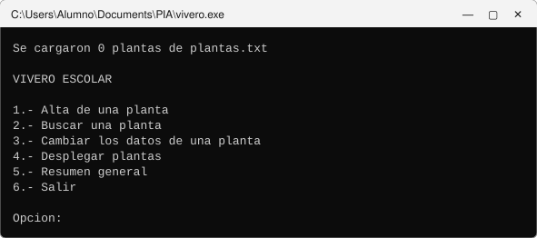

| Resultado esperado | Resultado obtenido | ¿Coincide? |
|---|---|---|
| `Se cargaron 0 plantas`; sin error | `Se cargaron 0 plantas de plantas.txt`; ningún error | Sí |

### Caso 2 — Consultas sin registros

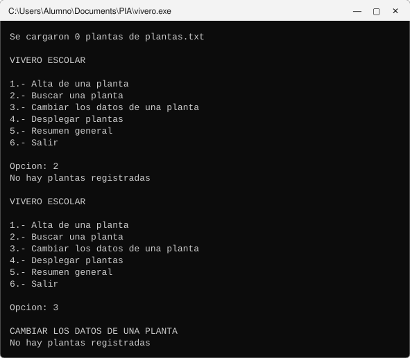

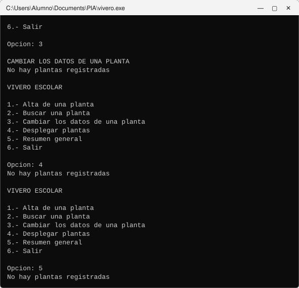

| Resultado esperado | Resultado obtenido | ¿Coincide? |
|---|---|---|
| Cada una avisa que no hay plantas registradas; la 2 y la 3 no piden la clave | Las 4 opciones avisaron que no hay plantas registradas; la 2 y la 3 no pidieron la clave | Sí |

### Caso 3 — El alta crea el archivo

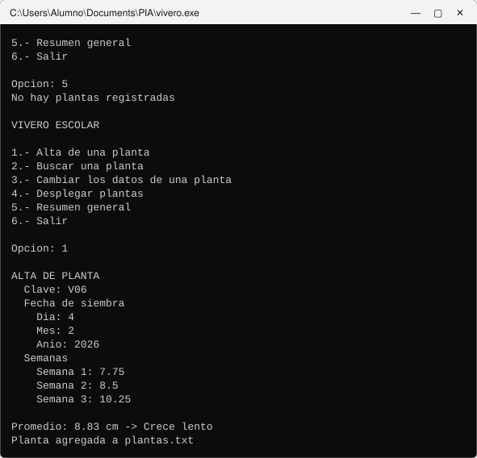

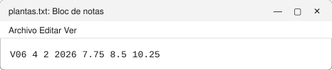

| Resultado esperado | Resultado obtenido | ¿Coincide? |
|---|---|---|
| Promedio 8.83 cm → Crece lento; aparece `plantas.txt` con un solo renglón: `V06 4 2 2026 7.75 8.5 10.25` | Promedio 8.83 cm → Crece lento; `plantas.txt` quedó con un solo renglón: `V06 4 2 2026 7.75 8.5 10.25` | Sí |

### Caso 4 — Carga del archivo inicial

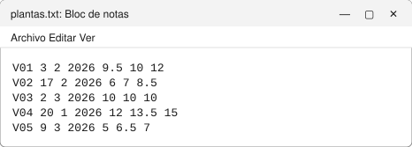

| Resultado esperado | Resultado obtenido | ¿Coincide? |
|---|---|---|
| `Se cargaron 5 plantas` | `Se cargaron 5 plantas de plantas.txt` | Sí |

### Caso 5 — Desplegar

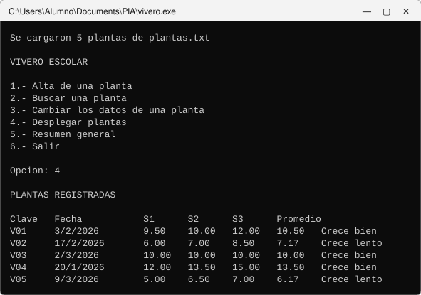

| Resultado esperado | Resultado obtenido | ¿Coincide? |
|---|---|---|
| Los 5, en el orden del archivo: `V01` 10.50 (Crece bien); `V02` 7.17 (Crece lento); `V03` 10.00 (Crece bien); `V04` 13.50 (Crece bien); `V05` 6.17 (Crece lento) | Los 5, en el orden del archivo: `V01` 10.50 (Crece bien); `V02` 7.17 (Crece lento); `V03` 10.00 (Crece bien); `V04` 13.50 (Crece bien); `V05` 6.17 (Crece lento) | Sí |

### Caso 6 — Búsqueda encontrada

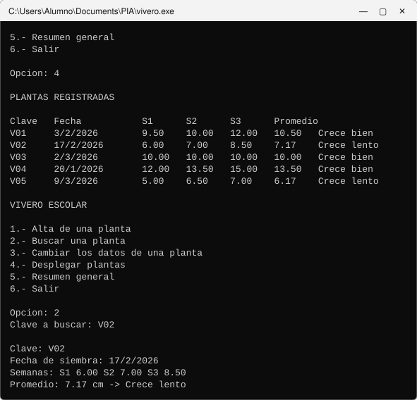

| Resultado esperado | Resultado obtenido | ¿Coincide? |
|---|---|---|
| Todos sus datos: 17/2/2026; 6.00, 7.00, 8.50; promedio 7.17 cm → Crece lento | Todos sus datos: 17/2/2026; 6.00, 7.00, 8.50; promedio 7.17 cm → Crece lento | Sí |

### Caso 7 — Búsqueda no encontrada

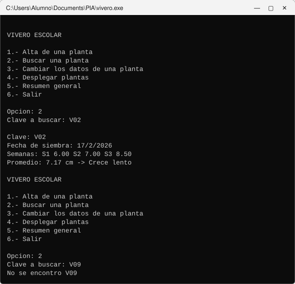

| Resultado esperado | Resultado obtenido | ¿Coincide? |
|---|---|---|
| Aviso de que no se encontró | `No se encontro V09` | Sí |

### Caso 8 — Mayúsculas distintas

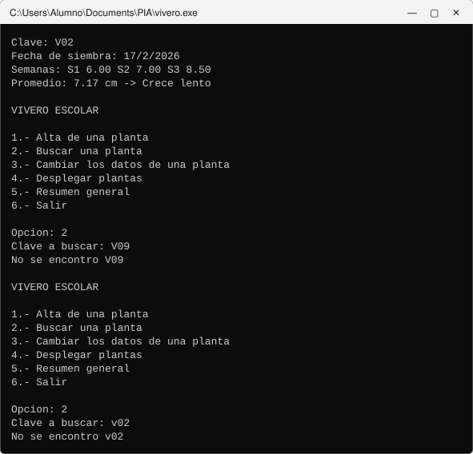

| Resultado esperado | Resultado obtenido | ¿Coincide? |
|---|---|---|
| Aviso de que no se encontró: `v02` y `V02` son textos distintos | `No se encontro v02` | Sí |

### Caso 9 — Resumen inicial

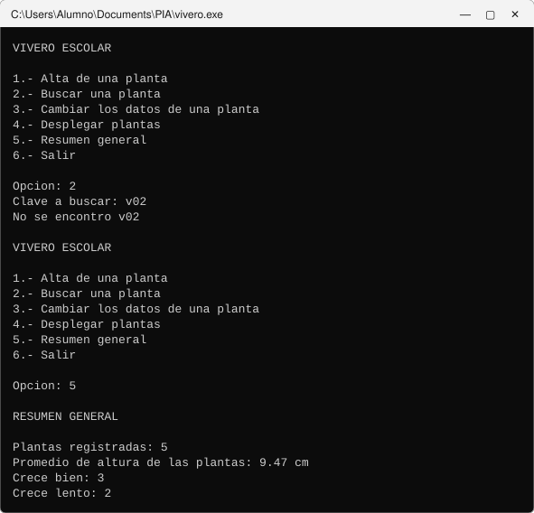

| Resultado esperado | Resultado obtenido | ¿Coincide? |
|---|---|---|
| 5 plantas; promedio de altura de las plantas: 9.47 cm; Crece bien: 3; Crece lento: 2 | 5 plantas; promedio 9.47 cm; Crece bien: 3; Crece lento: 2 | Sí |

### Caso 10 — Clave repetida

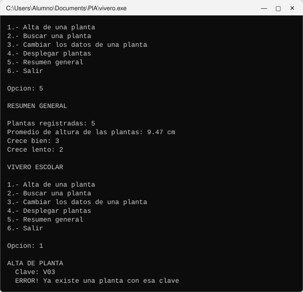

| Resultado esperado | Resultado obtenido | ¿Coincide? |
|---|---|---|
| Error; **no** pide la fecha ni los datos y el archivo no cambia | Error de clave repetida; regresó al menú sin pedir la fecha | Sí |

### Caso 11 — Alta con datos no válidos

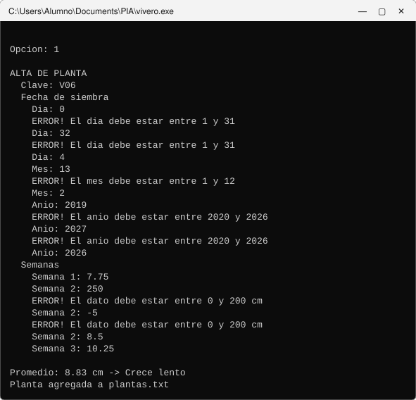

| Resultado esperado | Resultado obtenido | ¿Coincide? |
|---|---|---|
| Error en cada dato no válido y lo vuelve a pedir; promedio 8.83 cm → Crece lento | Un error por cada dato no válido; promedio 8.83 cm → Crece lento | Sí |

### Caso 12 — El alta agrega al final

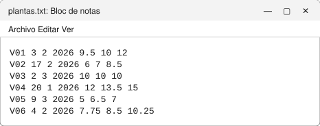

| Resultado esperado | Resultado obtenido | ¿Coincide? |
|---|---|---|
| 6 renglones: los 5 iniciales sin cambios y al final `V06 4 2 2026 7.75 8.5 10.25` | 6 renglones; al final `V06 4 2 2026 7.75 8.5 10.25` | Sí |

### Caso 13 — Cambio de planta que no existe

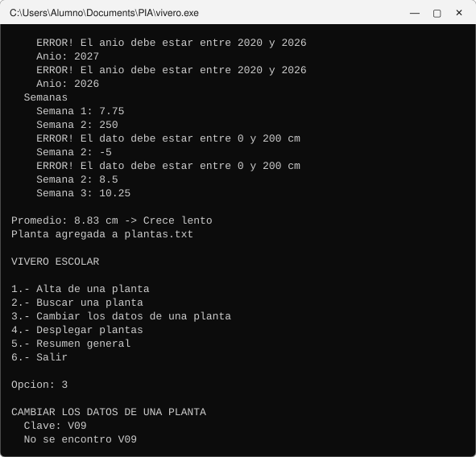

| Resultado esperado | Resultado obtenido | ¿Coincide? |
|---|---|---|
| Aviso de que no se encontró; no pide datos | `No se encontro V09`; no pidió datos | Sí |

### Caso 14 — Cambio de datos

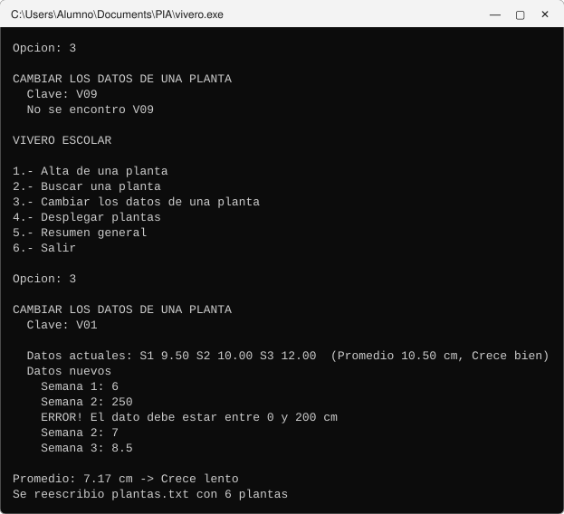

| Resultado esperado | Resultado obtenido | ¿Coincide? |
|---|---|---|
| Muestra sus datos actuales; error con 250 y vuelve a pedir esa misma semana; nuevo promedio 7.17 cm → Crece lento | Mostró los datos actuales y el error; nuevo promedio 7.17 cm → Crece lento | Sí |

### Caso 15 — El cambio reescribe el archivo

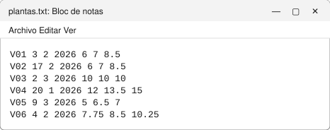

| Resultado esperado | Resultado obtenido | ¿Coincide? |
|---|---|---|
| 6 renglones en el mismo orden; solo cambió el primero: `V01 3 2 2026 6 7 8.5` | Solo cambió el primero: `V01 3 2 2026 6 7 8.5` | Sí |

### Caso 16 — Resumen después de los cambios

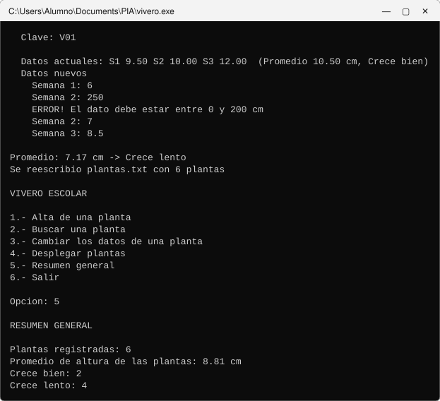

| Resultado esperado | Resultado obtenido | ¿Coincide? |
|---|---|---|
| 6 plantas; promedio de altura de las plantas: 8.81 cm; Crece bien: 2; Crece lento: 4 | 6 plantas; promedio 8.81 cm; Crece bien: 2; Crece lento: 4 | Sí |

### Caso 17 — Lo guardado no se pierde

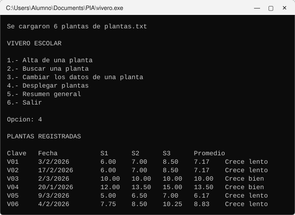

| Resultado esperado | Resultado obtenido | ¿Coincide? |
|---|---|---|
| `Se cargaron 6 plantas`; la tabla muestra los 6, con `V01` ya cambiada y `V06` al final | `Se cargaron 6 plantas`; `V01` con 7.17 y `V06` al final | Sí |

### Caso 18 — Registro lleno

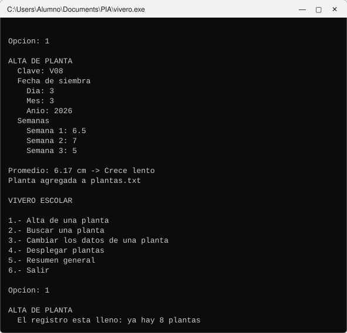

| Resultado esperado | Resultado obtenido | ¿Coincide? |
|---|---|---|
| Las dos se registran (8 en total); la tercera alta avisa que el registro está lleno y no pide la clave | Las dos altas se registraron; la tercera avisó que el registro está lleno | Sí |

### Caso 19 — Archivo con más renglones de los que caben

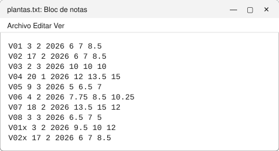

| Resultado esperado | Resultado obtenido | ¿Coincide? |
|---|---|---|
| `Se cargaron 8 plantas`; el programa no falla ni escribe fuera del arreglo | `Se cargaron 8 plantas`; no falló | Sí |

### Caso 20 — Opción inválida

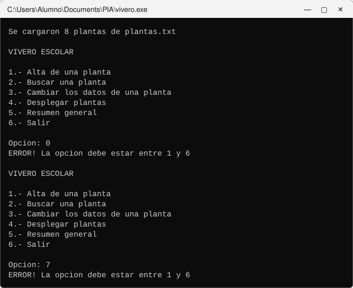

| Resultado esperado | Resultado obtenido | ¿Coincide? |
|---|---|---|
| Error; vuelve a mostrar el menú | Error con 0 y con 7; volvió a mostrar el menú | Sí |
